+++
title = 'Improving LM Performance with Better Initialization'
date = 2026-11-17
slug = 'makemore-init'
description = 'Dissecting the current makemore implementation to fix subtle errors that stem from sub-optimal network initialization'
tags = ['ai', 'language-models', 'neural-networks']
+++

In the [prior post]() in this series, we worked through (a simplification of) the techniques in [_A Neural Probabilistic Language Model_](https://www.jmlr.org/papers/volume3/bengio03a/bengio03a.pdf) (Bengio et al., 2003) to build a multi-layer perceptron that performs next-token prediction. Along with the architectural updates, we updated our training procedure, adding minibatches, learning rate selection and decay, and hyperparameter tuning.

In this post, we work with the same model and training process, and look closely at the problem of model initialization: how can we initialize the parameters of our neural network to optimize more effectively and achieve lower loss?

The content in this post is based on Andrej Karpathy's [YouTube video](https://www.youtube.com/watch?v=P6sfmUTpUmc&list=PLAqhIrjkxbuWI23v9cThsA9GvCAUhRvKZ&index=4) wherein he describes all of these concepts. The model itself is based on a 2003 implementation by [Bengio et al.](https://www.jmlr.org/papers/volume3/bengio03a/bengio03a.pdf). All of the source code that I produced for this post is available in my [`makemore-and-friends`](https://github.com/turingcompl33t/makemore-and-friends) repository.

## TL;DR

- We observe a high initial loss value caused by extreme values for the network's initial logits and fix it by scaling the network's output layer parameters
- We uncover saturation of the `tanh` activation function, and address it by scaling the initialization of the hidden layer parameters
- We formalize the scaling applied in the two prior steps through the lens of the paper [_Delving Deep into Rectifiers_](https://arxiv.org/abs/1502.01852) by He et al. and apply the initialization scaling recommended by this method

## Establishing a Baseline

The starting point for these experiments is just the code from the [previous post](), the completed version of which is in [`mlp.ipynb`](https://github.com/turingcompl33t/makemore-and-friends/blob/master/makemore/src/notebooks/mlp.ipynb).

In order to make tinkering with the model easier, I removed some of the abstractions, defining the model architecture inline in the notebook. The architecture is the same, and the optimization strategy is identical to the previous iteration. The code for the experiment covered in this post is in the [`mlp_init.ipynb`](https://github.com/turingcompl33t/makemore-and-friends/blob/master/makemore/src/notebooks/mlp_init.ipynb) notebook in my [`makemore-and-friends`](https://github.com/turingcompl33t/makemore-and-friends) repository.

Before starting to optimize the model's initialization, we gather a baseline for the current setup. I run 200,000 optimization steps with a batch size of 32, with a naive learning rate decay strategy (derived in the previous post). Under these conditions, we achieve the following training and validation losses:

```
train = 2.1189258098602295
val   = 2.160738468170166
```

and plotting the training loss against the training step looks like:

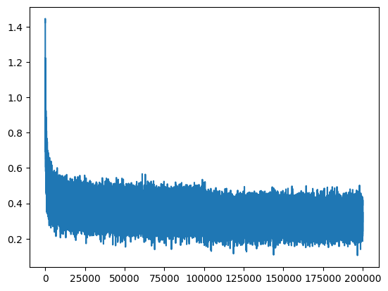

## Fixing the Initial Loss

The first thing we'll scrutinize is network initialization. We can quickly get a sense for how effectively the network is initialized by looking at the loss on our very first optimization step. In my case, the initial training loss is:

```
0/ 200000: 26.5404
...
```

Is this what we expect? Is it much higher than it should be? When beginning this experiment, I realized I didn't have any intuition for what the loss should look like.

To begin developing this intuition, we can compare this with the final training loss value (after 200,000 steps), which is `2.119`. So, the initial training loss is over an order of magnitude higher than the final training loss; this provides _some_ indication that the initialization is poor.

But we can develop our prior for the initial loss more systematically by thinking about the task. The model predicts the next token in the sequence. Our alphabet contains 27 tokens (a-z and the special `.` character). When the model is initialized randomly, we don't expect any character to be any more likely than any of the others. Therefore, the probability assigned to every character should be uniform, or `1/27`.

We can compute the loss we expect in this scenario with:

```python
-torch.tensor(1/27.0).log()
# 3.2958
```

So we would expect an initial loss of around `3.2958` if the initial setting of the network's parameters assigned uniform probability to each next token. But our actual initial loss is much higher at `26.5404`. This fact provides an indication that at initialization, the network produces a probability distribution that is extremely poor, far worse than even a uniform distribution of next-token probabilities.

### A Simplified Example

We can view a simple 4-dimensional example of the issue before addressing it in the real network. We can observe how the loss responds when the logits produced by the network take on different values. 

Suppose that our vocabulary consists of only four tokens, and that, for this particular training example, the token that follows the current context maps to index `2`. Then, when all of the logits are uniform, the initial loss looks like:

```python
logits = torch.tensor([0.0, 0.0, 0.0, 0.0])
probs = torch.softmax(logits, dim=0)
loss = -probs[2].log()
loss
# tensor(1.3863)
```

Suppose that, by chance, the magnitude of the logit that corresponds to the correct next token is relatively high. Then the loss looks like:

```python
logits = torch.tensor([0.0, 0.0, 5.0, 0.0])
probs = torch.softmax(logits, dim=0)
loss = -probs[2].log()
loss
# tensor(0.0200)
```

Now the loss is quite low. Further, suppose that the initial logits are (adversarially) bad:

```python
logits = torch.tensor([-3.0, 5.0, 0.0, 2.0])
probs = torch.softmax(logits, dim=0)
loss = -probs[2].log()
loss
# tensor(5.0553)
```

Now the loss is much higher than we anticipate with uniform logits.

### Examining the Real Network

This simplified example demonstrates a general principle: we want the logits to be roughly uniform when the network is initialized in order to avoid high initial loss [[1](#1-caveat-about-uniform-initial-loss)]. The logits don't need to be zero necessarily, but making them all uniform at zero is an easy way to achieve this.

If we examine the logits in the first iteration of our training run, they look like:

```python
logits[0]
# tensor([  9.8054, -10.7094, -18.9225,   4.5784,  25.0958,  12.3420,  25.2245,
#           2.3172,  23.1374, -15.8994,  -1.2803, -13.0714,  11.7869,  21.8830,
#         -10.2817, -10.7709,  13.7777,  -7.2771,  -1.5731,  15.3102,  -0.5203,
#         -18.8392,  30.8516,  16.5554, -18.1451,   2.9022, -36.2960],
#        grad_fn=<SelectBackward0>)
```

Here, our logits take on extreme values; this is what is causing the loss to be very high initially. As demonstrated in the simplified case, some of these logits with relatively high magnitude correspond to incorrect next-token predictions. When we compute the loss, these terms dominate and yield a much higher value than we would see with uniform logits.

How do we make the logits come out uniformly close to zero initially? We can determine this by walking through how our logits are computed, stepping through the network's forward pass in reverse. The logits themselves are computed by a linear layer:

```python
logits = h @ W2 + b2
```

We compute them by multiplying the output of the hidden layer with `W2` and adding the bias from `b2`. Therefore, we can force the logits towards `0` by setting `b2` to `0` and scaling `W2` down. To achieve this in the network initialization code:

```python
W2 = torch.randn(
    (hidden_layer_size, len(vocab)),
    generator=g,
) * 0.01
b2 = torch.zeros((len(vocab),), requires_grad=True)
```

Below, we'll cover why we don't set `W2` to `0` as well. This intervention would force our logits to `0`, but it introduces some additional negative consequences.

With this initialization update, we can recompute our initial loss:

```
0/ 200000: 3.3316
```

And we can verify that our logits look better:

```python
logits[0]
# tensor([ 0.0779, -0.0220, -0.0341,  0.0942, -0.0999, -0.2566, -0.1150, -0.0405,
#          0.1536, -0.0327, -0.0188,  0.1812, -0.1498, -0.1085, -0.0655,  0.1500,
#         -0.1604, -0.0298,  0.1155, -0.0634, -0.1085,  0.0809, -0.1203, -0.2351,
#         -0.0003, -0.0076, -0.0656], grad_fn=<SelectBackward0>)
```

Both are much improved. The first-iteration loss of `3.3316` is very close to the a priori expected loss value of `3.2958`. The logits themselves no longer take on high magnitudes, and they are relatively uniform.

Now we can re-run the full optimization process. The final training and validation losses are improved from the baseline: 

```
train = 2.0693347454071045
val   = 2.1326169967651367
```

We can see why when we plot the losses:

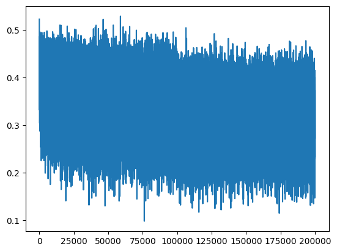

Now, the loss plot no longer looks like a hockey stick. Previously, when the initial loss was high, we spent some number of training steps just "squashing" the logits down to a reasonable magnitude. With this change, we spend all of our iterations doing the "hard" optimization work, and don't waste them just shrinking the weights to get rid of this high initial loss.

## Fixing the Saturated `tanh`

In the previous section, we identified a problem with the network's output, the logits, and addressed it by initializing the relevant network parameters more effectively (scaling `W2`, zeroing `b2`). Now we'll look upstream of the logits to address another issue that we can correct via better initialization.

The tensor `h` contains the outputs from our network's hidden layer: 

```python
# non-linearity (complete hidden layer)
h = torch.tanh(hpreact)
# output layer
logits = h @ W2 + b2
```

The values in `h` are the activations of the network's hidden states. `h` has dimensions:

```python
h.shape
# torch.Size([32, 200])
```

This is `32` examples (batch size = 32) by a hidden layer dimension of `200` neurons. We can start to see the problem if we visualize the distribution of the values within this tensor. We can achieve this by flattening the tensor and converting it to a `list` so that we can plot it naively:

```python
import matplotlib.pyplot as plt
plt.hist(h.view(-1).tolist(), 50);
```

The histogram of the tensor's values looks like:

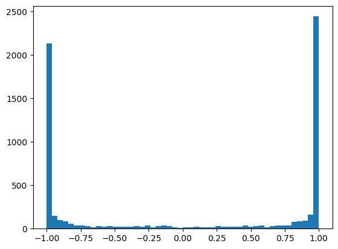

A glance at this distribution shows that a majority of these values are `-1` and `1`. The hyperbolic tangent activation maps values on the domain (-inf, inf) to (-1, 1). So the activation is squashing all of the inputs onto this range, and most values are saturating at the extremes. 

We can look at the pre-activations (the input to the `tanh` function) to see why this is happening:

```python
import matplotlib.pyplot as plt
plt.hist(hpreact.view(-1).tolist(), 50);
```

Here, the distribution looks like:

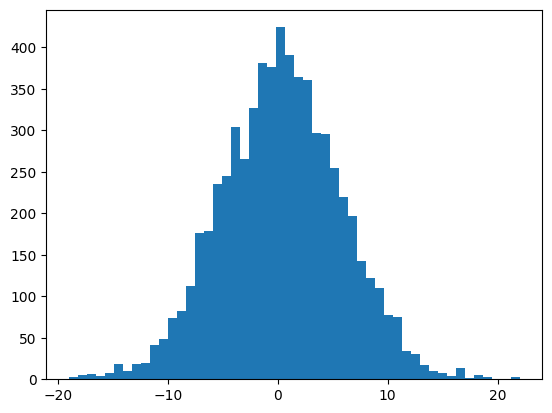

The range of the input is something like -20 to 20. We can compare this with the plot of the `tanh` function on the same range to see where the issue arises:

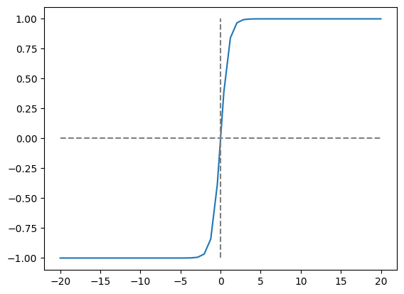

The high magnitude of the pre-activations is what is creating the strange distribution for the output of the tanh activation, and leading most values to saturate at -1 and 1. The pre-activations have plenty of density in the -10 to 10 range. However, for most of this range (say outside -2 to 2), the hyperbolic tangent function maps the input value to an output that is 1, or very close to it. The input distribution isn't appropriate for this activation.

### Why Is This a Problem?

Saturating the activation function is a problem because this distribution implies that gradients are being effectively lost as we backpropagate through the network during optimization.

To see this, we need to understand how the backward pass computes gradients through the `tanh` activation. The implementation of `tanh` from [micrograd](https://github.com/turingcompl33t/makemore-and-friends/blob/e6be5d86e2044aa3ebf633d9f4a25c95a3453928/micrograd/src/micrograd/engine.py#L90) looks like:

```python
def tanh(self) -> Value:
    x = self.data
    t = (math.exp(x) - math.exp(-x)) / (math.exp(x) + math.exp(-x))
    out = Value(t, (self,), "tanh")

    def _backward():
        self.grad += (1 - t**2) * out.grad

    out._backward = _backward
    return out
```

The backward pass through `tanh` is implemented as `(1 - t**2) * out.grad`. `t` is the output of the `tanh` function; we just saw that this is typically `-1` or `1`. In either of these cases, `1 - t**2` reduces to effectively `0`, meaning that the gradient backpropagated through the `tanh` is also `0` (or near it).

This makes intuitive sense as well when we think about what the gradient is telling us. Because we are in a saturated region of the `tanh` function, small modifications to the input will not have much impact on the loss, meaning the gradient should be small (near zero). If the activation of `tanh` is exactly `0`, then the gradient is merely passed through during backpropagation. As we get closer to the tails, the gradient only decreases as the magnitude of the activation increases towards `-1` or `1`.

If we look at a plot of hyperbolic tangent on the domain (-5, 5):

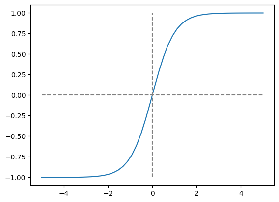

We can distinguish between the _active_ and _inactive_ parts of the domain. Between about -2 and 2, the function maps inputs relatively smoothly; changing the input by some amount has a noticeable impact on the output value. This is the active part of the domain. In contrast, outside this area (below -2, above 2), the function saturates, and changes to the input have little impact on the output.

In general, our network will be better-behaved if the inputs to the activation largely fall within this active part of the activation's domain. Outside this, the activation has little effect.

### Aside: Dead Neurons

We can get a sense of how big a problem this is for our network by visualizing all of the activations from the hidden layer for a single batch.

```python
plt.imshow(h.abs() > 0.99, cmap="gray", interpolation="nearest")
```

This produces a plot that looks like:

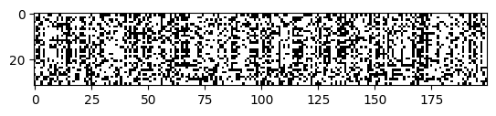

In this plot, we see the activation from each neuron for each of the 32 examples. White boxes in this image represent neurons where the absolute value of the activation is greater than 0.99--neurons where we are in the "flat tail" region for the `tanh` activation.

In our case, we observe a high proportion of white cells, indicating many saturated activations. If it were the case that any single column of cells were entirely white, indicating that for this particular neuron, none of the examples in the batch produces an activation in the active part, this would constitute a "dead neuron". For such a neuron, all 32 examples in the batch cause the activation to be sufficiently high-magnitude that the gradient is lost during backpropagation, meaning that the neuron can never learn--updates are lost because the gradient is zeroed.

We don't have any dead neurons in our network, but the distribution of activations is still far from optimal.

### Fixing Activation Saturation

We apply a fix by examining the pre-activations once more. We saw that the problem is that the values are too extreme--too far from zero. We can scale the parameters for `W1` and `b1` to force the values produced by the pre-activation closer to zero, and thereby fix the distribution post-activation.

```python
# hidden layer
W1 = torch.randn(
    (
        BLOCK_SIZE * embedding_dimension,
        hidden_layer_size,
    ),
    generator=g,
) * 0.2
b1 = torch.randn(hidden_layer_size, generator=g) * 0.01
```

We can play with the amount of scaling to apply here. There is a tradeoff between the level of entropy that we get and the saturation fix that we're currently applying. Earlier, I mentioned that we don't want to set a parameter tensor to `0` completely (talking about `W2` at the time, but the same logic applies here to `W1`). 

With this update to the initialization, the activation distribution looks much better:

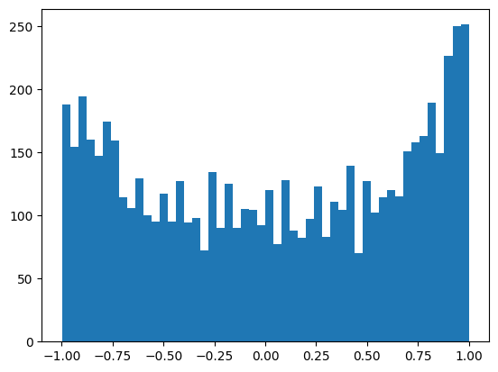

because the pre-activation distribution is much less extreme (now about -3 to 3):

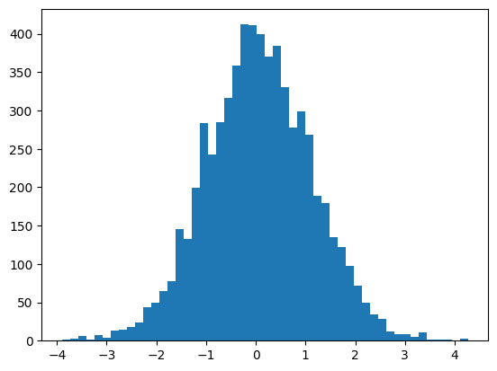

and we see an almost complete absence of examples for which any neuron produces an activation that results in a lost gradient update:

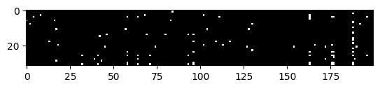

When we run the complete optimization process with this fix applied, we achieve new low values for training and validation loss:

```
train = 2.036147117614746
val   = 2.101691484451294
```

## Calculating the Initialization Scale (Kaiming Initialization)

At this point, our network initialization looks like this:

```python
# hidden layer
W1 = torch.randn(
    (
        BLOCK_SIZE * embedding_dimension,
        hidden_layer_size,
    ),
    generator=g,
) * 0.2
b1 = torch.randn(hidden_layer_size, generator=g) * 0.01
# output layer
W2 = torch.randn(
    (hidden_layer_size, len(vocab)),
    generator=g,
) * 0.01
b2 = torch.randn(len(vocab, ), generator=g) * 0.0
```

The tensor dimension parameters, combined with the `generator` arguments, clutter this visually, but the point is the presence of the various scaling factors we've introduced in order to "fix" various sub-optimal aspects of the optimization process that we've observed.

We scale each of our parameter tensors (aside from `C`) by some value in order to address some downstream issue (high initial loss, `tanh` saturation). We came up with these scaling factors by playing around with the network and observing the empirical results (e.g. how initial loss looked).

This is fine, but it's labor-intensive. It turns out there is a more principled way that we can arrive at some of these scaling factors that gives us (a) some assurance that we've selected an optimal value and (b) the ability to arrive at them without manual experimentation.

### A Motivating Example

We'll work our way towards this initialization method via a motivating example. Consider a simplified neural network that looks like this:

```python
x = torch.randn(1000, 10)
w = torch.randn(10, 200)
y = x @ w
```

We have our input tensor `x` multiplied by a weight tensor `w` to compute the output tensor `y`. Both `x` and `w` are sampled randomly from a normal distribution with mean `0` and variance `1` (via [`torch.randn`](https://docs.pytorch.org/docs/2.14/generated/torch.randn.html)).

If we compare the mean and standard deviation of the values in `x` and `y`, we get:

```
mean(x) = -0.0005, std(x) = 1.0109
mean(y) = -0.0102, std(y) = 3.1495
```

So `x` has mean `0` and standard deviation `1`, as expected. Meanwhile, `y` has the same mean, but the standard deviation has increased to roughly `3`. We can observe the same phenomenon in a plot of the two distributions:

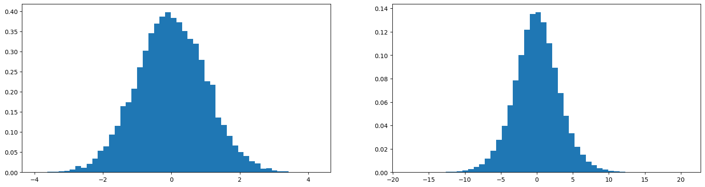

The matrix multiplication by `w` has the effect of "stretching out" the distribution of the values that is present in the input `x`. As we scale `w`, we can see how this changes the standard deviation for `y`. If we scale it up, the standard deviation increases:

```python
w = torch.randn(10, 200) * 5.0
```

`y` now has a standard deviation of `15.5825`. Conversely, scaling it down decreases the standard deviation of `y`:

```python
w = torch.randn(10, 200) * 0.1
```

This scaling factor gives a standard deviation of `0.3187`. In general, we want to keep a consistent mean of `0` and standard deviation of `1` throughout our entire network.

Why is this? Our network is a stack of layers, each of which multiplies its input by a weight matrix. As we just saw, each multiplication rescales the distribution of the values passing through it. In a network with many layers, these rescalings compound: if each layer stretches the distribution by a factor of 3, then after 10 layers the activations have a standard deviation of roughly $3^{10} \approx 59,000$. Similarly, if each layer shrinks the distribution, the activations quickly collapse toward zero.

We've already seen both failure modes in miniature. When the pre-activations were too large, `tanh` saturated and gradients vanished; when the logits were too large, our initial loss was far higher than it should have been. Activations that are too _small_ cause a subtler problem: `tanh` behaves almost like the identity near zero, so the nonlinearity contributes little and the signal fades as it moves through the network.

The same argument applies to the backward pass. Gradients flow back through the same weight matrices (transposed), so they also explode or vanish exponentially with depth if the scale isn't controlled. Keeping the activations roughly unit-Gaussian at every layer keeps the inputs to each nonlinearity in its active region and keeps gradients at a reasonable magnitude throughout the network. The specific target of mean `0` and standard deviation `1` is somewhat arbitrary; what matters is that the scale stays _consistent_ from layer to layer.

Our network has only a single hidden layer, so the compounding effect is mild here; we were able to fix our problems by hand with a couple of scaling factors. In deeper networks, however, controlling the scale at every layer becomes essential, and hand-tuning a scaling factor for each one quickly becomes impractical.

The question becomes: how do we find the scaling factor that allows us to do this?

Mathematically, the way to accomplish this is to scale by dividing element-wise by the square root of the _fan-in_ for the layer, where the fan-in is just the number of inputs. Here, `w` has shape `(10, 200)`, so we can implement this for our network like:

```python
w = torch.randn(10, 200) * 1/10**0.5
```

I implement division by multiplying by the multiplicative inverse. This keeps the calculation consistent with the form it will take in subsequent updates.

With this scale applied, now we get a standard deviation of `0.9848` for the output Gaussian `y`, very close to our target of `1`.

### Kaiming Initialization

Now we want to apply this same type of reasoning to the initialization of our neural network. The approach that we'll follow comes from the influential paper [Delving Deep into Rectifiers](https://arxiv.org/abs/1502.01852) by _He et al._

Here, the authors specifically look at the ReLU and PReLU activations, but we can apply the results to our `tanh` activations as well.

He et al.'s analysis introduces the notion of _gain_--a small value that augments the scaling factor we found above (one over the square root of the fan-in) to account for the specific nature of the nonlinearity. For instance, for the ReLU activation function, they find that the scaling factor needed to optimally preserve the Gaussian is:

$$\frac{\sqrt{2}}{\sqrt{n}}$$

where $n$ represents the fan-in.

In general, they find that initialization in which values are sampled from $\mathcal{N}(0, std^2)$ preserves the Gaussian optimally, where:

$$std = \frac{gain}{\sqrt{fan\_mode}}$$

Here, $fan\_mode$ is either the layer's fan-in (its number of inputs) or its fan-out (its number of outputs), and the choice controls which pass through the network the initialization protects. Using the fan-in preserves the variance of the activations in the forward pass, which is the version we derived in the example above. Using the fan-out instead preserves the variance of the gradients in the backward pass, since gradients flow back through each layer's outputs. He et al. show that either choice is sufficient in practice. PyTorch exposes this choice through the `mode` argument to `kaiming_normal_`, which defaults to `"fan_in"`; that's the version we'll use.

This concept is now known as "Kaiming initialization" or "Kaiming init". The method is so pervasive that it is implemented directly in PyTorch within its [init module](https://docs.pytorch.org/docs/2.14/nn.init.html#torch.nn.init.kaiming_normal_). The module provides its own table of values for _gain_ that make the initialization unambiguous:

| Nonlinearity | Gain |
| --- | --- |
|  Linear / Identity | 1 |
| Conv{1,2,3}D | 1 |
| Sigmoid | 1 |
| Tanh | $\frac{5}{3}$ |
| ReLU | $\sqrt{2}$ |
| Leaky ReLU | $\sqrt{\frac{2}{1 + negative\_slope^2}}$ |
| SELU | $\frac{3}{4}$ |

We see that the gain for the ReLU nonlinearity is $\sqrt{2}$, like we saw above. For tanh, the gain is $\frac{5}{3}$; this is what we'll use in our implementation.

### Applying to Our Network

According to Kaiming initialization, we want to initialize our network such that the parameters are distributed like $\mathcal{N}(0, std^2)$ where

$$std = \frac{gain}{\sqrt{fan\_in}}$$

Currently, our initialization looks like:

```python
W1 = torch.randn(
    (
        BLOCK_SIZE * embedding_dimension,
        hidden_layer_size,
    ),
    generator=g,
) * 0.2
```

Because we use `torch.randn` for initialization, our tensor is already initialized with a distribution that resembles a Gaussian with mean 0 and standard deviation 0.2, because of the previous scaling we applied. We can merely swap this scaling by 0.2 with the value we compute according to the Kaiming init method:

```python
kaiming_init_scale = (5/3) / ((BLOCK_SIZE * embedding_dimension)**0.5)
```

Where `BLOCK_SIZE * embedding_dimension` is our fan-in. The resolved value comes out as: `0.3042903097250923`, meaning we had previously selected a scaling factor that was just `0.1` off the value suggested by the Kaiming initialization method.

Completing the initialization:

```python
kaiming_init_scale = (5/3) / ((BLOCK_SIZE * embedding_dimension)**0.5)
W1 = torch.randn(
    (
        BLOCK_SIZE * embedding_dimension,
        hidden_layer_size,
    ),
    generator=g,
) * kaiming_init_scale
```

Now we can run optimization again to observe the impact on our final loss values:

```
train = 2.0376644134521484
val   = 2.106989622116089
```

Ultimately, the new initialization makes very little difference, and actually degrades validation performance slightly.

## Final Loss Log

The table below records the final losses achieved through these experiments. Losses are rounded to 3 decimal places.

| Description | Training Loss | Validation Loss |
| --- | --- | --- |
| Baseline | `2.119` | `2.161` |
| Fix the Initial Loss | `2.070` | `2.133` |
| Fix `tanh` Saturation | `2.036` | `2.102` |
| Add Kaiming Init | `2.038` | `2.107` |

The [unabridged loss log](#2-unabridged-loss-log) contains the loss values without rounding.

## Footnotes

This section contains footnotes for this post.

### [1] Caveat about Uniform Initial Loss

I imagine this is only the case when we don't have a strong prior about how the logits should look. For instance, could we achieve better performance here if we took advantage of our prior knowledge of character frequencies? Could we initialize the network in such a way that e.g. the logit that corresponds to the letter `e` is relatively higher than the others to achieve better performance?

### [2] Unabridged Loss Log

Baseline:

```
train = 2.1189258098602295
val   = 2.160738468170166
```

After fixing the initial loss:

```
train = 2.0693347454071045
val   = 2.1326169967651367
```

After fixing `tanh` saturation:

```
train = 2.036147117614746
val   = 2.101691484451294
```

After adding Kaiming initialization:

```
train = 2.0376644134521484
val   = 2.106989622116089
```
