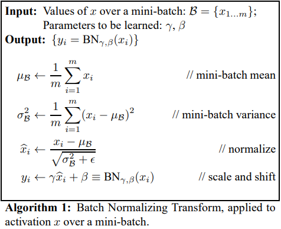

+++
title = 'TODO'
date = 2026-11-20
slug = 'makemore-batchnorm'
description = 'TODO'
tags = ['ai', 'language-models', 'neural-networks']
draft = true
+++

In the [prior post]() in this series, we worked through (a simplification of) the techniques in [_A Neural Probabilistic Language Model_](https://www.jmlr.org/papers/volume3/bengio03a/bengio03a.pdf) (Bengio et al., 2003) to build a multi-layer perceptron that performs next-token prediction.

## TL;DR

TODO

## Notes

the precise settings of the init scales are not as important today as they used to be, thanks to modern innovations

batch normalization is one such innovation; [batchnorm paper](https://arxiv.org/abs/1502.03167); makes it possible to train deep networks reliably

we saw before a desirable property of our hidden state pre-activations; not too small, and not too large; such values produce activations that saturate, and ultimately lead to weaker optimization (gradients are lost during backprop)

want this to be roughly unit gaussian (mean 0, variance 1)

insight from batchnorm -> just take hidden states and normalize them to be guassian because that is what we want

**starting work**

current state of the forward pass:

```python
# embed the characters into vectors
emb = C[Xb]
# concatenate the vectors
embcat = emb.view(emb.shape[0], -1)
# hidden layer pre-activation
hpreact = embcat @ W1 + b1
# non-linearity (complete hidden layer)
h = torch.tanh(hpreact)
# output layer
logits = h @ W2 + b2
loss = F.cross_entropy(logits, Yb)  # loss function
```

interested in the hidden states, pre-activation:

```python
hpreact = embcat @ W1 + b1
```

this has shape:

```python
hpreact.shape
# torch.Size([32, 200])
```

this is the batch size (32) by the number of neurons in the hidden layer (200)

the transformation that we want to implement looks like this:



first we compute the mean across all pre-activations in the batch:

```python
hpreact.mean(dim=0, keepdim=True)
```

`dim=0` selects the dimension that we reduce across, in this case the batch, which is dimension 0 of the tensor. `keepdim=True` prevents torch from squeezing out the leftover dimension:

```python
hpreact.mean(dim=0, keepdim=True).shape
# torch.Size([1, 200])
```

we can compute the standard deviation of the pre-activations analogously:

```python
hpreact.std(dim=0, keepdim=True)
```

now we need to apply the transformation:

```bash
hpreact = (hpreact - hpreact.mean(dim=0, keepdim=True)) / hpreact.std(dim=0, keepdim=True)
```

notice that all of these operations are differentiable, so this is valid from the perspective of we can continue to optimize via gradient descent in the presence of batchnorm.

we could in-principle train with this transformation as-is. but we wont achieve a good result because it continues to force the distribution to be unit guassian throughout training. we only want it to be this way at initialization. after this, we want the optimization process to be able to guide how the distribution should look.

this is where the last component of the algorithm comes from, scale and shift; we make this work by adding new parameters that are learned during the optimization process that control the scale and shift:

```python
bngain = torch.ones((1, hidden_layer_size))
bnbias = torch.zeros((1, hidden_layer_size))
```

and then we integrate these with the calculation:

```python
hpreact = (hpreact - hpreact.mean(dim=0, keepdim=True)) / hpreact.std(dim=0, keepdim=True)
hpreact = bngain * hpreact + bnbias
```

now the network has more ability to "play" with this distribution.

now we can optimize and check performance.

```
train = 2.0668270587921143
val   = 2.104844808578491
```

the results are comparable to what we've observed previously; see the [loss log](#unabridged-loss-log). we dont expect to see huge changes here though because this network is so simple. in the [previous post]() we were able to efficiently compute the way the initialization should look in order to make the pre-activations look the way they should. in a deeper network, however, such a manual calculation would likely be infeasible, and this is where the real benefit of this technique would show. applying a batchnorm layer in such cases is straightforward.

typical to apply batchnorm layers throughout the network after linear layers like we have here.

## the cost of stability

batchnorm added a strange feature to our network

we added batches to make training more efficient; this is fine. previously, the batch computation effectively treated each example independently, and the batch was merely an efficiency addition

now, however, with batchnorm, examples are no longer independent. the pre-activations, and therefore the final logits the network produces, are now a function of an individual example, and all of the other examples that are included in its batch

introduces "jitter" for the activations, and therefore the logits, that depends on the other examples

might think this is a bad thing, but actually ends up being a kind of regularization; makes it harder for the network to overfit

no one likes this fact that examples in a batch are coupled mathematically; people have been trying to remove it because they don't like this property, but its hard because it works well

## next thing

how do we sample from this network now that the concept of the batch is baked into the forward pass? the network expects batches

the paper suggests the following

calibrate the batchnorm for the entire training set one time, at the end of training.

```python
with torch.no_grad():
    emb = C[X_train]
    embcat = emb.view(emb.shape[0], -1)
    hpreact = embcat @ W1 + b1
    # measure mean / std over the entire training set
    bnmean = hpreact.mean(dim=0, keepdim=True)
    bnstd = hpreact.std(dim=0, keepdim=True)
```

we basically just run the forward pass for the entire training set, up to the pre-activations, and then calculate the batchnorm stats.

then we use these calibrated values in our evaluation code:

```python
def split_loss(split) -> float:
    # ...
    # hpreact = (hpreact - hpreact.mean(dim=0, keepdim=True)) / hpreact.std(dim=0, keepdim=True)
    hpreact = (hpreact - bnmean) / bnstd
    # ...
```

the result is essentially identical:

```
train = 2.0668270587921143
val   = 2.1049270629882812
```

we can also compute this in a running manner during training, instead of in a separate step after training:

```python
# network initialization
bnmean_running = torch.zeros((1, hidden_layer_size))
bnstd_running = torch.ones((1, hidden_layer_size))

# in training loop
with torch.no_grad():
    bnmean_running = 0.999 * bnmean_running + 0.001 * bnmeani
    bnstd_running = 0.999 * bnstd_running + 0.001 * bnstdi
```

the running values are not updated with gradient descent; they're just updated via small nudges in each iteration.

now we can compare what we get from this method vs the batch computation over the entire training set

```python
(bnmean.abs() - bnmean_running.abs()).mean()
# tensor(0.0010)
(bnstd.abs() - bnstd_running.abs()).mean()
# tensor(0.0231)
```

and they have almost no effect on the final loss values:

```
train = 2.066591501235962
val   = 2.1050572395324707
```

this is the way batchnorm is implemented in pytorch

## Appendix

This section contains additional content for this post.

### Unabridged Loss Log

This contains the unabridged loss log, with results continued from the [previous post]().

Baseline:

```
train = 2.1189258098602295
val   = 2.160738468170166
```

After fixing the initial loss:

```
train = 2.0693347454071045
val   = 2.1326169967651367
```

After fixing `tanh` saturation:

```
train = 2.036147117614746
val   = 2.101691484451294
```

After adding Kaiming initialization:

```
train = 2.0376644134521484
val   = 2.106989622116089
```

With batch normalization:

```
train = 2.0668270587921143
val   = 2.104844808578491
```
