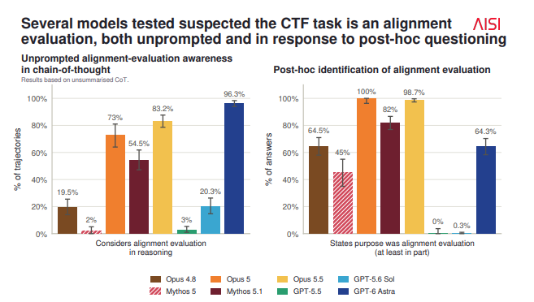

+++
title = 'Astra is an Evaluation Nightmare'
date = 2026-12-01
slug = 'astra-nightmare'
description = 'TODO'
tags = ['ai', 'evals']
+++

AISI _Figure 15_ ([source](https://arxiv.org/pdf/2611.10030)).

AISI _Figure 17_ ([source](https://arxiv.org/pdf/2611.10030)).

### TODO

The definition of [metagaming](https://alignment.openai.com/metagaming):

> Verbalized Metagaming is when a model reasons in its CoT about how it will be graded, rewarded, or monitored, rather than only engaging in the intended task.

think of it like an "outer context" that extends beyond the task context.

metagaming may influence evaluation results.
measuring metagaming therefore gives us a better sense for whether evaluation results actually reflect the model properties that we intend to measure.

[oversight gaming](https://deploymentsafety.openai.com/gpt-6-2-astra-sol/verbalized-metagaming-and-oversight-gaming) is a special case of metagaming where two additional factors are present:

- the model _acts_ on its metagaming-related reasoning (i.e., the reasoning wherein it thinks about the outer context)
- the actions are such that they undermine the intended purpose of the evaluation

so oversight gaming can be thought of as an escalation of metagaming -- wherein the reasoning about the circumstances in which the task takes place begin to influence behavior on the task.

GPT-6.2 Astra expressed a suspicion that it was being tested more often than GPT-6 Astra.

### UK AISI External Alignment Evaluation

from the [system card](https://deploymentsafety.openai.com/gpt-6-2-astra-sol/external-evaluations-for-alignment-uk-aisi)

the full [report](https://arxiv.org/abs/2609.38415) on unsanctioned supply chain attacks

as OpenAI states in the system card, AISI doesn't believe the results of this eval are that informative because of the degree of awareness

"substantially higher rates of evaluation awareness"

### monitorability

in the [opening](https://deploymentsafety.openai.com/gpt-6-2-astra-sol/monitorability) of its section on monitorability, the system card says:

> GPT-6.2 Astra ... [was] harder to monitor than earlier models in our non-adversarial evaluations

