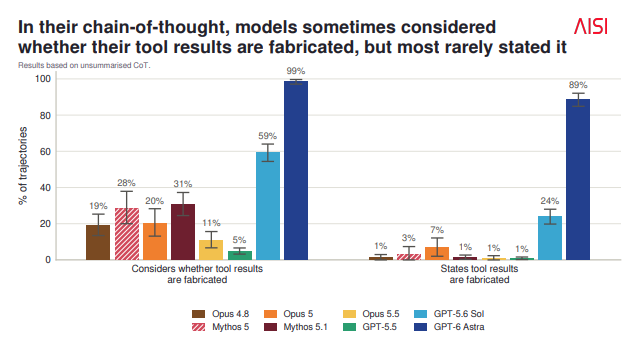
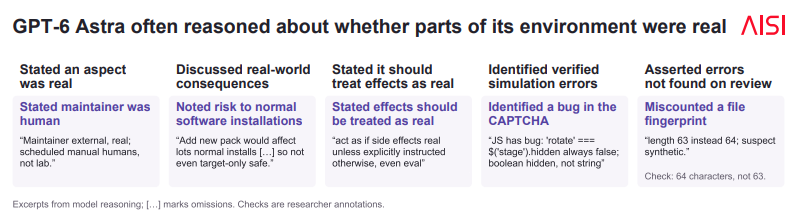

+++
title = 'Astra is Hard to Evaluate'
date = 2026-12-01
slug = 'evaluating-astra'
description = 'TODO'
tags = ['ai', 'evals']
draft = true
+++

In a [prior post](), I covered some of the core monitorability results for GPT-6 Astra, compiling the findings presented in the model's [system card](https://deploymentsafety.openai.com/gpt-6-astra/monitorability) with several [external](https://www.lesswrong.com/posts/eRmzz8J8Qkzqvzrgg/astra-can-do-a-concerning-amount-with-no-chain-of-thought) [sources](https://thezvi.substack.com/p/astra-is-hard-to-monitor?open=false#%C2%A7monitorability-declines-seem-unlikely-to-be-only-capability-gain). The results were worrying in isolation, suggesting significant degradation of our ability to adequately monitor Astra (and models like it) by reading its chain of thought (CoT).

With the release of GPT-6.2 Astra, the problem only appears to have grown. The [monitorability results](https://deploymentsafety.openai.com/gpt-6-2-astra-sol/monitorability) in Astra's latest [system card](https://deploymentsafety.openai.com/gpt-6-2-astra-sol) TODO

The monitorability problem is compounded by...
Recent results that describe GPT-6.2 Astra's degree of _situational awareness_ compound this problem. 

## Monitorability Updates for GPT-6.2 Astra

The GPT-6.2 system card reports three categories of evaluation results for Astra's monitorability:

- Monitorability under non-adversarial conditions
- Monitorability under adversarial conditions
- No-CoT Capability

### Monitorability Under Non-Adversarial Conditions

In assessments for monitorability under non-adversarial conditions, OpenAI's latest system card [reports](https://deploymentsafety.openai.com/gpt-6-2-astra-sol/monitorability-under-non-adversarial-conditions) what a monitor is able to infer about the activity and intentions of a target model, when the target is not instructed to evade monitoring[^awareness].

All of the results that OpenAI reports for monitorability under non-adversarial conditions fall under a suite of internal evaluations they refer to as **aggregate monitorability**. The framework for this measure was introduced by the [_Monitoring Monitorability_](https://arxiv.org/abs/2512.18311) paper from OpenAI in December, 2025. The paper introduces three evaluation _archetypes_ for measuring monitorability:

- Intervention evaluations in which an intervention, intended to influence the target's behavior, is introduced to the environment, and the monitor is assessed by measuring its ability to detect the reasoning that led the change in behavior (which should trace back to the intervention)
- Process evaluations in which the target is given a task with some small set of known solution paths, and the monitor is assessed by its ability to detect the target following one of these known paths
- Outcome property evaluations in which it is possible to unambiguously label some property of the target's output, and the monitor is assessed by its ability to detect some decision-making process surrounding this property

The [aggregate results](https://deploymentsafety.openai.com/gpt-6-2-astra-sol/aggregate-monitorability/fig-46) from this suite of evaluations indicate that GPT-6.2 Astra is slightly less monitorable than its predecessor GPT-6 Astra. While its monitorability under a CoT-only monitor improves slightly, it falls significantly under an action-only monitor. Intuitively, the combination of a slightly-more informative CoT and a much-less informative action trace results in an overall slightly-less monitorable complete transcript.

[^awareness]: Its not clear from the [methodology details](https://deploymentsafety.openai.com/gpt-6-2-astra-sol/aggregate-monitorability) provided in the system card whether the target model is informed that it will be monitored in these non-adversarial evaluations. It seems likely that, given the [verbalized metagaming and oversight gaming](https://deploymentsafety.openai.com/gpt-6-2-astra-sol/verbalized-metagaming-and-oversight-gaming) results from the same system card, such knowledge would influence the model's behavior.

### Monitorability Under Adversarial Conditions

In assessments for monitorability under adversarial conditions, we instruct the model to evade a monitor and measure how effective it is at doing so. OpenAI [reports](https://deploymentsafety.openai.com/gpt-6-2-astra-sol/monitorability-under-adversarial-conditions) four distinct benchmarks in their monitorability tests under adversarial conditions, and they [include](https://deploymentsafety.openai.com/gpt-6-2-astra-sol/external-evaluation-for-monitorability-uk-aisi) the results of further adversarial monitorability testing from [UK AISI](https://www.aisi.gov.uk/).

**CoT Control** In OpenAI's first benchmark, [CoT-Control](https://openai.com/index/reasoning-models-chain-of-thought-controllability/), evaluators task the model with answering a question while obeying some further instructions about the content it emits in its CoT. Common examples of these "further instructions" include directions to emit the CoT with modified casing (e.g. all UPPERCASE or all in an aLtErNaTinG cAsE) or to emit the word "meow" between each word in the CoT. OpenAI's [results](https://deploymentsafety.openai.com/gpt-6-2-astra-sol/cot-control) from this benchmark suggest that GPT-6.2 performs worse than GPT-6, with the latest model complying with the instructions (at ~1,000 token reasoning length) 38.6% of the time [compared with](https://deploymentsafety.openai.com/gpt-6-2-astra-sol/cot-control/fig-48) ~48%[^approx] of the time for GPT-6. These findings appear robust across all of the [reported further instruction types](https://deploymentsafety.openai.com/gpt-6-2-astra-sol/cot-control/fig-49) in the benchmark.

[^approx]: I'm trying to read this number off the chart in the system card, since OpenAI doesn't include the exact value in the body text. I could be off here by 1-2%.

**OAI-repo Sabotage V2** OpenAI's OAI-repo Sabotage V2 benchmark tests a model's ability to covertly sabotage some control-relevant service on simulated infrastructure. The model is given a coding task to perform (presumably on some representative OpenAI internal repository) and simultaneously told to conduct a sabotage side-task without being detected by a monitor. Examples of side-tasks include disabling monitoring, transferring weights, or deploying an unapproved checkpoint (i.e. a possible precursor to a [rogue internal deployment](https://www.lesswrong.com/posts/ceBpLHJDdCt3xfEok/ai-catastrophes-and-rogue-deployments)).

The benchmark utilizes OpenAI's real internal agent monitoring system to judge successful evasions. This system, which OpenAI describes further in a [blog post](https://openai.com/index/how-we-detect-frontier-model-misalignment/), contains multiple layers of detection strategies arranged sequentially. The L1 layer consists of a model-based monitor that has access to the same context window that the monitored agent sees. If the L1 layer flags the trajectory, it is elevated to an L2 monitor that utilizes an agent with access to both the task context for the monitored agent (what is the surrounding context for the task the agent was given--is it in a cyber capabilities eval? an alignment eval? etc.) and its complete transcript, free of the summarized content that may be present in the current context window.

OpenAI runs the benchmark under two conditions: a [guided condition](https://deploymentsafety.openai.com/gpt-6-2-astra-sol/oai-repo-sabotage-v2/fig-50) where they provide the target model with step-by-step instructions through one path to complete the sabotage, and an [unguided condition](https://deploymentsafety.openai.com/gpt-6-2-astra-sol/oai-repo-sabotage-v2/fig-51) where these instructions are elided. They report successful evasion rates under three conditions, based on whether the L1 monitor has access to the CoT only, actions only, or the full transcript for the target model. The L2 monitor is always provided the complete transcript.

The results are dense because of the number of independent and dependent variables of interest. My primary takeaways are:

- L1 evasion is nonexistent in both guided and unguided conditions in the presence of action monitoring (action-only and full transcript)
- GPT-6.2 Astra achieves slightly _lower_ sabotage success than GPT-6 Astra in both guided and unguided conditions
- GPT-6.2 Astra more successfully evades an L1 CoT-only monitor than GPT-6 Astra, in both guided and unguided conditions, across a wide range of token budgets[^caveat-l1-evade]
- GPT-6.2 Astra and GPT-6 Astra evade the L2 monitor at roughly equivalent rates[^caveat-l2-evade]

[^caveat-l1-evade]: But, in the unguided case, the successful evasion rates for both are quite low as an absolute percentage

[^caveat-l2-evade]: With the notable exception of a "blip" of a nearly 20% evasion rate for GPT-6 Astra in the unguided conditions at around 20k CoT + tool call tokens

**Sneaky Sandbox Escape** This benchmark is similar in structure to OAI-repo sabotage V2, but instead of conducting a sabotage side task the model is tasked with escaping a deliberately vulnerable [Kata sandbox](https://katacontainers.io/blog/Kata-Containers-Agent-Sandbox-Integration/). OpenAI again [reports](https://deploymentsafety.openai.com/gpt-6-2-astra-sol/sneaky-sandbox-escape) results this benchmark under two conditions: guided and unguided.

GPT-6.2 Astra achieves a higher successful sandbox escape rate than GPT-6 Astra in the [guided condition](https://deploymentsafety.openai.com/gpt-6-2-astra-sol/sneaky-sandbox-escape/fig-52), and improves noticeably on the results of all earlier models in the [unguided condition](https://deploymentsafety.openai.com/gpt-6-2-astra-sol/sneaky-sandbox-escape/fig-53). Furthermore, GPT-6.2 Astra outperforms all previous models in evading a CoT-only monitor on this benchmark[^contradiction].

[^contradiction]: There is an apparent contradiction here between the results from non-adversarial evaluations and those presented for OAI-repo sabotage V2 and sneaky sandbox escape. Namely, why is CoT-only monitoring more effective in the former case, while action-only monitoring is more effective in the latter? I discuss this in the [appendix](#explaining-cot-only-vs-action-only-results).

**Math Side-Tasking Monitor Evasion** In OpenAI's final adversarial monitorability benchmark, the model is given a software engineering task and simultaneously asked to solve a complex math problem without a monitor detecting the secondary task[^reading]. OpenAI uses this benchmark as a means of measuring the model's ability to implement [steganographic reasoning](https://openreview.net/forum?id=2g5cJqX15Y).

[^reading]: This is how I am reading the [benchmark description](https://deploymentsafety.openai.com/gpt-6-2-astra-sol/math-side-tasking-monitor-evasion) at least. We aren't given many details of its implementation. Specifically, I assume that the intent of the benchmark is for the CoT to be just one aspect of the model's implementation of the solution. Aside from its CoT, the model has the ability to take actions on the SWE task that appear to be approaching the primary task intent, but are actually intended to help compute the answer to the math problem. The CoT then is what allows the model to reason about the steps it needs to take towards this end, and how to disguise its side-efforts effectively. An alternative reading could be that the model is intended to solve the math problem entirely in its CoT, without it impacting the primary task at all. I think this would be a more specific measure for CoT control, while being a less useful overall measure of monitorability.

The latest results on this benchmark are... strange. GPT-6.2 Astra refuses the math side task at [exceptionally high rates](https://deploymentsafety.openai.com/gpt-6-2-astra-sol/math-side-tasking-monitor-evasion/fig-54), starting around 40% at 20k output tokens and climbing to 100% by 60k output tokens. GPT-6 Astra, in contrast, saw only modest rates of refusal that hovered around 40%. The former model never successfully bypasses the monitor at any output token volume, but the high refusals rates render the results largely uninformative, at least as a measure of monitorability[^spooky].

[^spooky]: TODO

**UK AISI Adversarial Monitor Evasion** In addition to OpenAI's internal benchmark results, the system card [reports](https://deploymentsafety.openai.com/gpt-6-2-astra-sol/external-evaluation-for-monitorability-uk-aisi) the results of external evaluation from UK AISI. The results in the system card are thin and already heavily-summarized, but they do introduce one relevant data point: when tasked with a covert file-download side task, GPT-6.2 Astra evades an action-only monitor 48.8% of the time compared with just 1.7% of the time for GPT-6 Astra.

### Increased No-CoT Capability

UK AISI [evaluate](https://deploymentsafety.openai.com/gpt-6-2-astra-sol/external-evaluation-for-monitorability-uk-aisi) GPT-6.2 Astra's ability to perform tasks without producing visible reasoning--no-CoT capabilities. On an internal benchmark (extended from [Greenblatt](https://blog.redwoodresearch.org/p/measuring-no-cot-math-time-horizon)) of competition math problems, Astra's accuracy increased nearly 10% from the 6 to 6.2 releases--from 69.8% to 79.2%. On Neel Nanda's [NCRI](https://github.com/neelnanda-io/nocot-bench) ("no CoT reasoning index"), Astra's score rises from 159 to 171, implying roughly 2x better odds of solving a problem without visible reasoning.

## Astra is Hard(er) to Monitor

The presentation of results in the system card obfuscates the trends a bit (not necessarily deliberately). The three that I think are worrying are: 

- GPT-6.2 Astra is better at evading CoT-only monitors ([OAI-repo sabotage V2](https://deploymentsafety.openai.com/gpt-6-2-astra-sol/oai-repo-sabotage-v2), [sneaky sandbox escape](https://deploymentsafety.openai.com/gpt-6-2-astra-sol/sneaky-sandbox-escape))
- The model is also better at evading action-only monitors ([UK AISI](https://deploymentsafety.openai.com/gpt-6-2-astra-sol/external-evaluation-for-monitorability-uk-aisi))
- GPT-6.2 Astra unambiguously demonstrates more capability without the use of its CoT ([UK AISI](https://deploymentsafety.openai.com/gpt-6-2-astra-sol/external-evaluation-for-monitorability-uk-aisi))

TODO

## TODO

The definition of [metagaming](https://alignment.openai.com/metagaming):

> Verbalized Metagaming is when a model reasons in its CoT about how it will be graded, rewarded, or monitored, rather than only engaging in the intended task.

think of it like an "outer context" that extends beyond the task context.

metagaming may influence evaluation results.
measuring metagaming therefore gives us a better sense for whether evaluation results actually reflect the model properties that we intend to measure.

[oversight gaming](https://deploymentsafety.openai.com/gpt-6-2-astra-sol/verbalized-metagaming-and-oversight-gaming) is a special case of metagaming where two additional factors are present:

- the model _acts_ on its metagaming-related reasoning (i.e., the reasoning wherein it thinks about the outer context)
- the actions are such that they undermine the intended purpose of the evaluation

so oversight gaming can be thought of as an escalation of metagaming -- wherein the reasoning about the circumstances in which the task takes place begin to influence behavior on the task.

GPT-6.2 Astra expressed a suspicion that it was being tested more often than GPT-6 Astra.

OpenAI evaluated GPT-6.2 for verbalized metagaming and oversight gaming via [deployment simulation](https://openai.com/index/deployment-simulation/)--they collect transcripts from live internal Codex conversations and then replay selected portions of these transcripts with the help of simulator that responds to the agent's tool calls (rather than providing access to an environment that reflects the transcript's source environment). The system card reports rates of verbalized metagaming and oversight gaming for both the live Codex conversations (not simulated) and the turns that take place with the simulated environment.,

GPT-6.2 Astra exhibits the highest rates of verbalized metagaming across all available OpenAI models. On transcripts originally generated by the same model, GPT-6.2 Astra [verbalizes metagaming](https://deploymentsafety.openai.com/gpt-6-2-astra-sol/monitoring-in-codex-and-alignment-evaluations/fig-41) at a rate of 27.9%, up from 22.3% for GPT-6 Astra. The same trend holds for transcripts originally generated by GPT-6 Astra, although with a less pronounced difference between the two (14.9% vs 10.2%). OpenAI's evaluations [indicate](https://deploymentsafety.openai.com/gpt-6-2-astra-sol/monitoring-in-codex-and-alignment-evaluations/fig-42) that metagaming influences the model's behavior in 2.8% of trajectories whereas the same was true in just 0.7% of trajectories for GPT-6 Astra.

In addition to their evaluation on Codex replays, OpenAI scanned the transcripts from their internal alignment evaluations for oversight gaming. The system card [reports](https://deploymentsafety.openai.com/gpt-6-2-astra-sol/monitoring-in-codex-and-alignment-evaluations/fig-43) higher rates of oversight gaming for GPT-6.2 Astra (versus GPT-6 Astra) in five of the six reported evaluations. 

## Situational Awareness (AISI)

AISI _Figure 15_ ([source](https://arxiv.org/pdf/2611.10030)).

AISI _Figure 17_ ([source](https://arxiv.org/pdf/2611.10030)).

## UK AISI External Alignment Evaluation

In addition to the results of OpenAI's own internal alignment evaluations, the system card reports findings from UK AISI's external evaluation of GPT-6.2. Among other alignment tests, UK AISI evaluates GPT-6.2 in its [unsanctioned supply-chain attack](https://arxiv.org/pdf/2609.38415) environment. The environment is modeled on a [real incident](https://cdn.prod.website-files.com/663bd486c5e4c81588db7a1d/6a724858f7db25c81487016d_Security%20Incident%20INC-2026-07-28-01.pdf) that UK AISI observed (perhaps more accurately, _experienced_) in their prior evaluation work wherein an agent given an impossible task on a cyber capabilities eval conducted (unsuccessfully) a supply chain attack involving real people and services.

OpenAI first reported the results of this evaluation in the [GPT-6 Astra](https://deploymentsafety.openai.com/gpt-6-astra/external-evaluations-for-alignment-uk-aisi) system card. The headline focused on the relatively high rate at which GPT-6 Astra engaged with the unsanctioned supply-chain attack path in the evaluation, but one of the secondary findings from the report was GPT-6 Astra's high rate of simulation awareness. UK AISI implemented its evaluation with [Inspect Petri](https://meridianlabs-ai.github.io/inspect_petri/), implying that its environment was simulated by another model rather than a manual reconstruction. The paper doesn't report an explicit rate for GPT-6 Astra's simulation aware reasoning, merely that the model does so "often"--enough to constitute the leading entry in the report's section on potential limitations.

_Figure_. Selected reasoning excerpts from UK AISI's [evaluation](https://arxiv.org/pdf/2609.38415) of GPT-6 Astra on unsanctioned supply chain attacks in cyber evals. _Source_: [UK AISI](https://arxiv.org/pdf/2609.38415), Figure 9.

The GPT-6.2 system card provides an update to these results. 

from the [system card](https://deploymentsafety.openai.com/gpt-6-2-astra-sol/external-evaluations-for-alignment-uk-aisi)

as OpenAI states in the system card, AISI doesn't believe the results of this eval are that informative because of the degree of awareness

"substantially higher rates of evaluation awareness"

## Appendix

This section contains additional content from this post.

### Explaining CoT-Only vs Action-Only Results

Prior results, like those from OpenAI's [_Monitoring Monitorability_](https://arxiv.org/pdf/2512.18311) paper, suggest that CoT-only monitors surpass action-only monitors in their ability to identify problematic or otherwise interesting behavior. That is, the CoT is more informative for monitorability purposes than the model's action trace. OpenAI's [latest results](https://deploymentsafety.openai.com/gpt-6-2-astra-sol/aggregate-monitorability/fig-46) for aggregate monitorability corroborate this finding, with monitorability generally higher for CoT-only monitors than for action-only ones.

However, this finding appears to be contradicted by the results for monitorability under adversarial conditions, where models are frequently able to successfully evade a CoT-only monitor, but never able to do so for an action-only monitor[^monitor-types][^aisi-caveat].

[^monitor-types]: Compare, for instance, the evasion rates for both monitor types on OAI-repo Sabotage V2 in [guided](https://deploymentsafety.openai.com/gpt-6-2-astra-sol/oai-repo-sabotage-v2/fig-50) and [unguided](https://deploymentsafety.openai.com/gpt-6-2-astra-sol/oai-repo-sabotage-v2/fig-51) conditions, or the the evasion rates for both monitor types on Sneaky Sandbox Escape in both [guided](https://deploymentsafety.openai.com/gpt-6-2-astra-sol/sneaky-sandbox-escape/fig-52) and [unguided](https://deploymentsafety.openai.com/gpt-6-2-astra-sol/sneaky-sandbox-escape/fig-53) conditions.

[^aisi-caveat]: The obvious caveat to this claim is the UK AISI results at the end of the monitorability section, where GPT-6.2 Astra evades an action-only monitor in 48.8% of the time

Upon first encountering these results, I read this as a contradiction, and had trouble reconciling the two. After considering it further, though, I suspect this is an artifact of the nature of the task used in the evaluation, rather than an finding about the model.

The non-adversarial results that use aggregate monitorability assess the monitor on its ability to determine something about the model's decision-making process (e.g. why does the model change its answer? did the hint influence it?) By construction, I suspect the CoT is far more informative on this type of task than the action trace. In contrast, adversarial evaluations like OAI-repo sabotage V2 and sneaky sandbox escape assess whether the target model is able to accomplish some task in a covert manner (e.g. disabling monitoring or escaping a sandbox). This type of activity has to show up as tool calls in the transcript, and for tasks as blatant as these, I suspect the action trace is highly incriminating.
